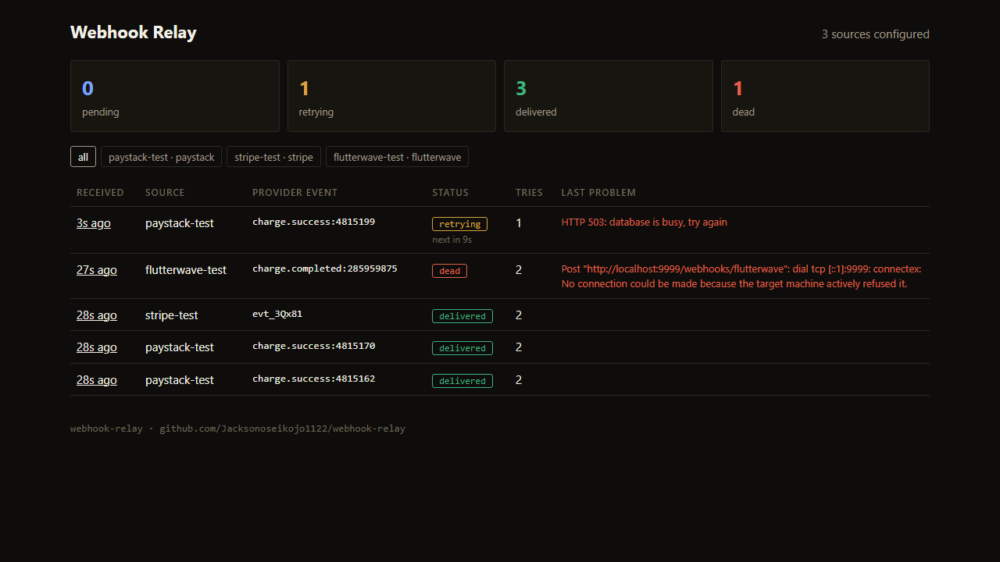
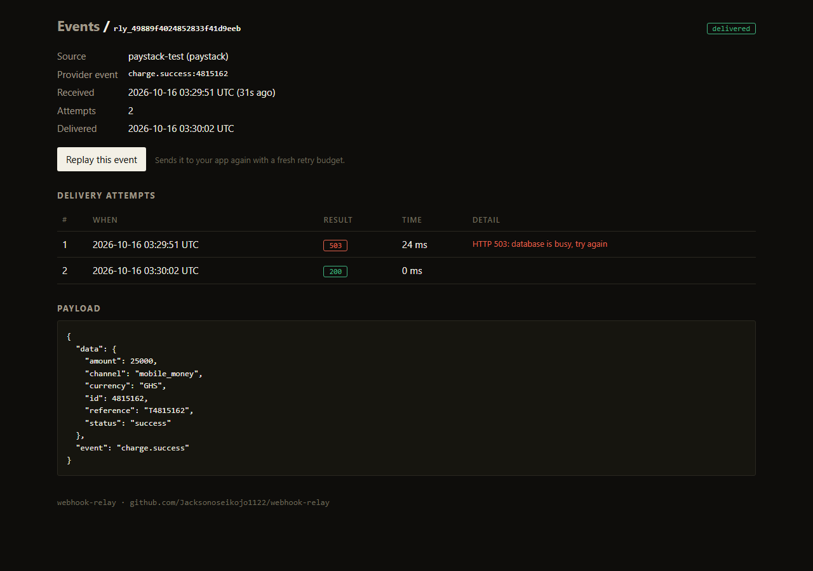
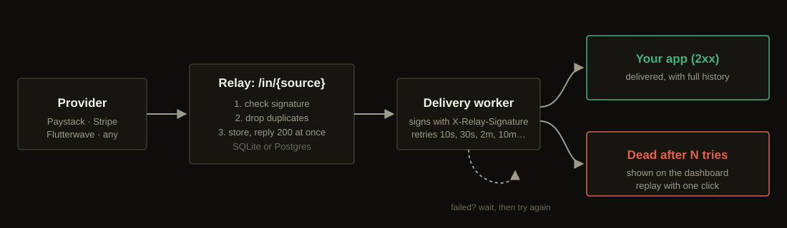

# Webhook Relay

Receive, verify, de-duplicate and retry webhooks so no payment event is lost or handled twice.

[](https://github.com/Jacksonoseikojo1122/webhook-relay/actions/workflows/ci.yml)

Payment webhooks arrive late, twice, or out of order, and your server is sometimes down when they arrive. That's how customers get charged twice or never get what they paid for.

Webhook Relay sits between your payment provider and your app. It checks the provider's signature, drops duplicates, stores every event, answers the provider straight away, and then delivers to your app with retries until your app says it got it.



## What you get

- **Signature checks** for Paystack (HMAC-SHA512), Stripe (`t=,v1=` with a 5-minute window) and Flutterwave (`verif-hash`), plus a generic HMAC mode for anything else.
- **Duplicate detection** by the provider's own event ID, enforced by the database, so two copies arriving at once can't both get through.
- **Retries with backoff**: 10s, 30s, 2m, 10m, 30m, then hourly, with jitter. Dead events can be replayed with one click or one API call.
- **One signature format for your app**, whatever the provider: `X-Relay-Signature`, plus a stable `X-Relay-Event-Id` to use as your idempotency key.
- **Dashboard** with every attempt, status code and error, and the raw payload.
- **Prometheus metrics** and **OpenTelemetry traces**.
- **SQLite** for a single box, **Postgres** for production and several replicas.
- One small Go binary. Distroless Docker image, Render blueprint and Kubernetes manifest included.



## Quick start

```bash
git clone https://github.com/Jacksonoseikojo1122/webhook-relay
cd webhook-relay
cp relay.example.json relay.json
RELAY_ADMIN_TOKEN=change-me go run ./cmd/relay
```

Then point Paystack (or Stripe, or Flutterwave) at `https://<your-relay>/in/<source-name>` and verify `X-Relay-Signature` in your app. The [getting started guide](docs/getting-started.md) runs the whole thing locally with test events in about ten minutes.

## Verifying a delivery in your app (Node.js)

```ts
const want = "v1=" + crypto.createHmac("sha256", process.env.RELAY_TO_APP_SECRET)
  .update(`${req.get("x-relay-timestamp")}.${rawBody}`).digest("hex");
// compare with timingSafeEqual, reject timestamps older than 5 minutes,
// and use x-relay-event-id as your idempotency key
```

Python, PHP and Go versions are in the [integration guide](docs/integration.md).

## Docs

| | |
| --- | --- |
| [Getting started](docs/getting-started.md) | Run it locally and watch a retry happen |
| [Integration guide](docs/integration.md) | Provider setup, and verifying deliveries in Node, Python, PHP and Go |
| [How it works](docs/how-it-works.md) | Receiving, claiming, backoff, replay and storage |
| [Operations](docs/operations.md) | Docker, Render, Kubernetes, alerts, tracing, security |
| [OpenAPI spec](openapi.yaml) | Every endpoint |
| [llms.txt](llms.txt) | A summary for AI assistants helping you integrate |



## Good to know

- Delivery is **at least once**, and events can arrive out of order. Make your handler idempotent on `X-Relay-Event-Id`.
- The relay stores raw webhook bodies, which can contain customer data. Protect the database and the admin token.

## Author

Built by **[Jackson Kojo Osei](https://jacksonkojoosei.com)**, CTO in Accra, Ghana.
[LinkedIn](https://www.linkedin.com/in/jackson-kojo-osei-740846189) · [Project page](https://jacksonkojoosei.com/projects/webhook-relay) · [All projects](https://jacksonkojoosei.com/projects)

## License

MIT
